# NoCrast

A local-first productivity and procrastination tracker. Create a task and its timer is already running, and NoCrast quietly notes when you wander off, so you can see your own habits without being scolded for them.

Everything runs in your browser. There are no accounts, no servers and no analytics.

> **Status:** core app complete. Typecheck, lint, unit and component tests, the Playwright end-to-end suite and a Lighthouse audit have all been run and pass (see [Testing](#testing)).

---

## Why I built it

Most productivity tools tell you what to do. Very few show you what you actually did. NoCrast measures how long work really takes, warns you before deadlines, and notices when attention drifts, without pretending to know why. It only ever records a *possible* distraction, you decide what each one was, and declared breaks are never held against you. Your data never leaves your browser. The full story, with the design decisions and the problems I solved, is in the [case study](docs/CASE_STUDY.md).

## Demo


[Watch the full video](docs/demo/nocrast-demo.mp4) (1 min 48 s, with captions).

## Screenshots

Sample data from a simulated session.

| Today | Break mode |
|---|---|
| 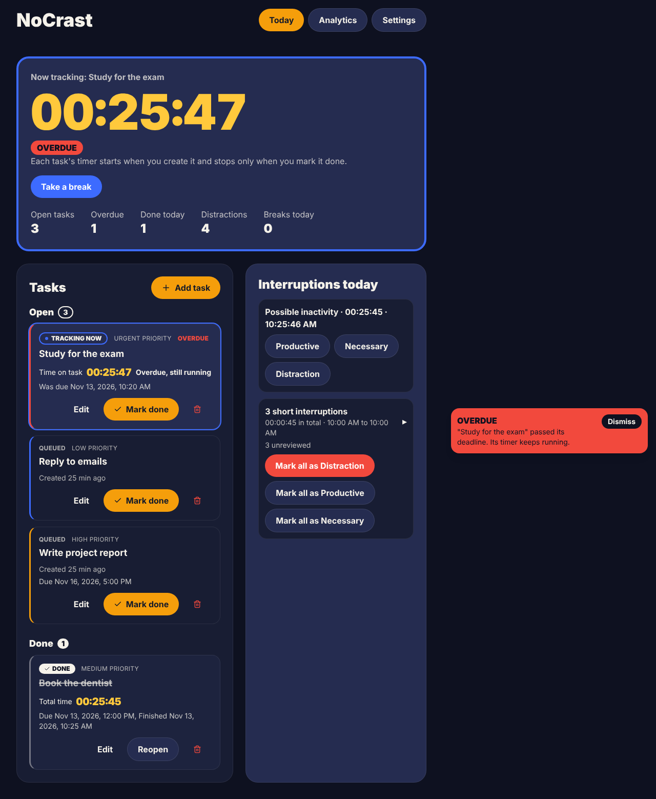 | 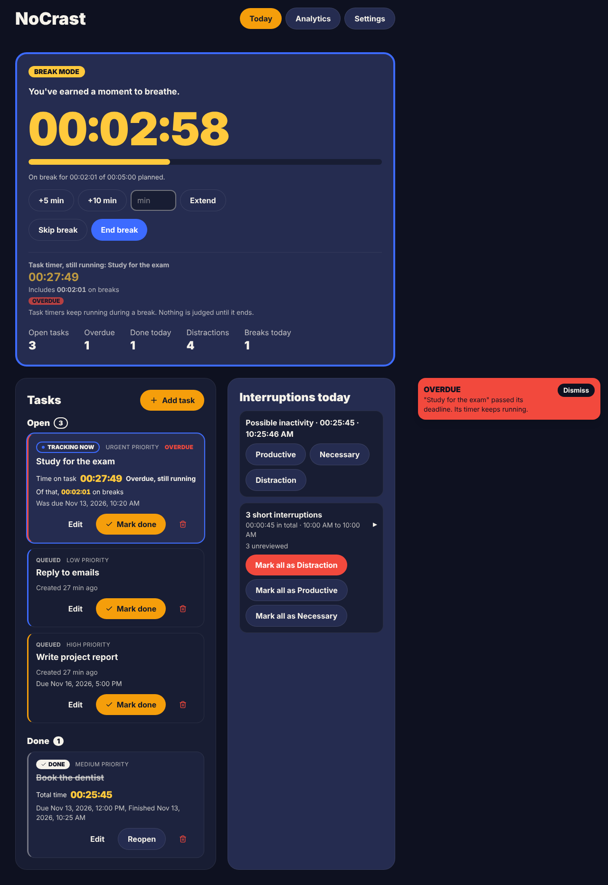 |

| New task | Take a break |
|---|---|
| 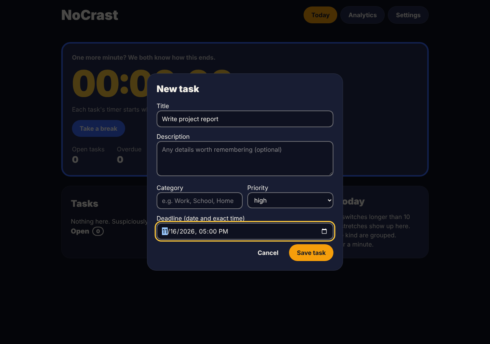 | 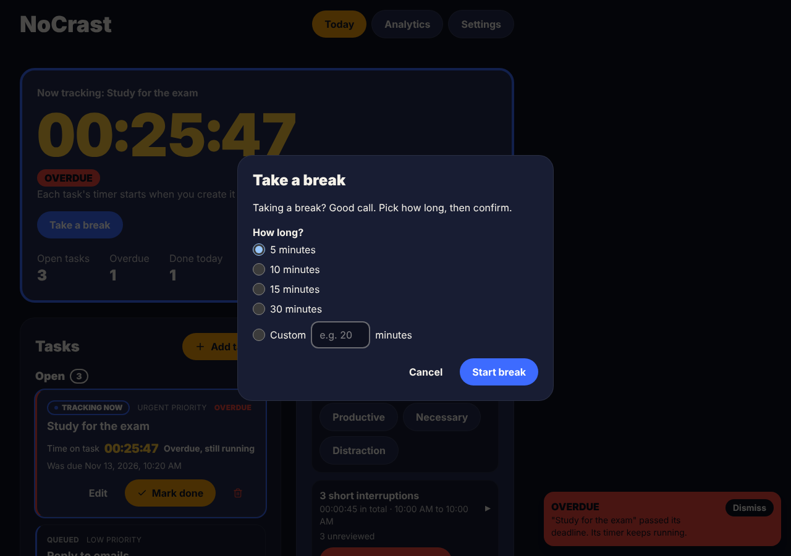 |

| Deadline notices | Grouped interruptions |
|---|---|
| 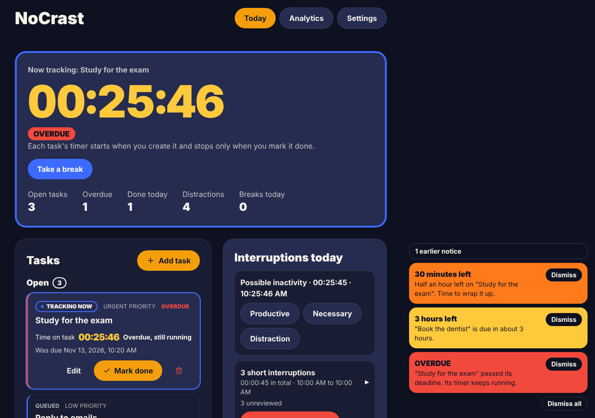 | 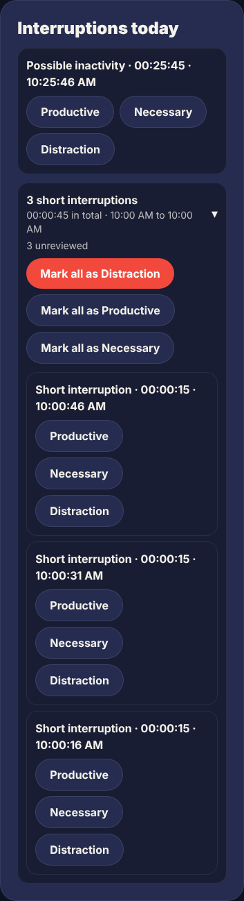 |

| Analytics | Settings |
|---|---|
| 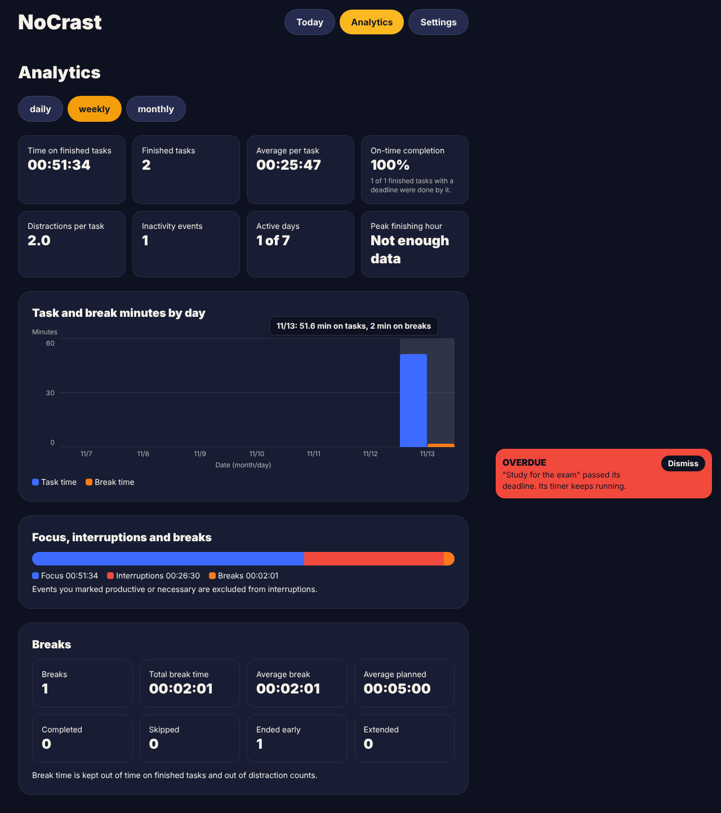 | 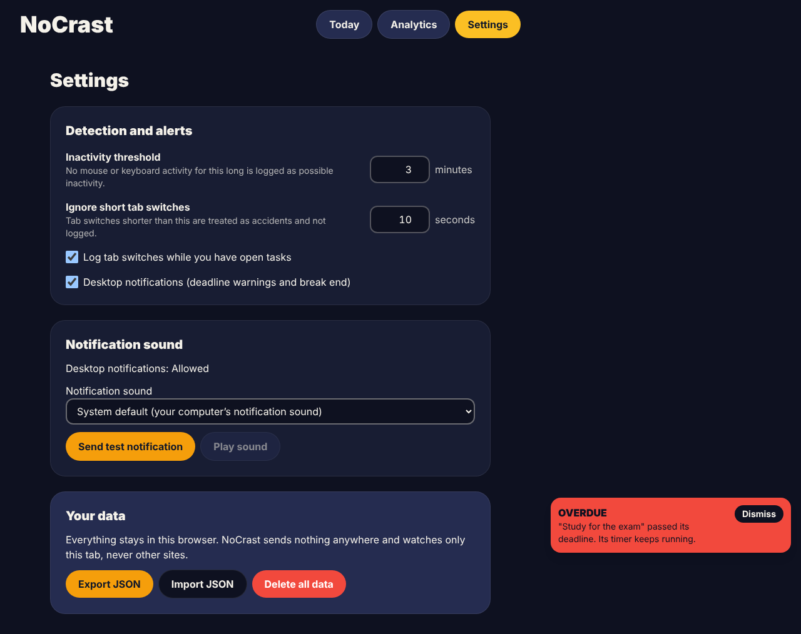 |

On a phone:

<p>
  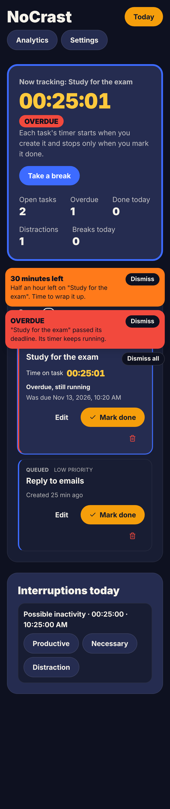
  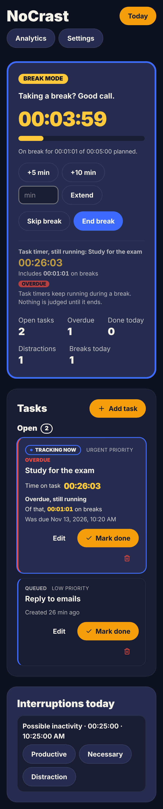
  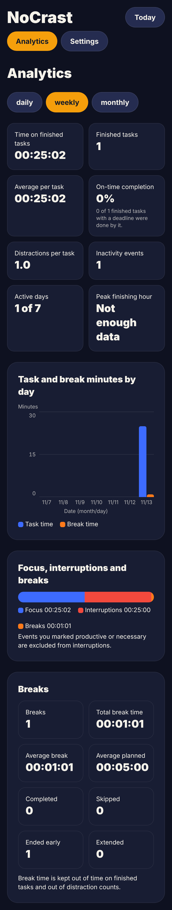
</p>

## Features

- **Tasks:** create, edit, complete and delete tasks with a description, category, priority (low, medium, high, urgent), and an optional deadline with an exact date and time. Overdue tasks are labelled in text, not just color.
- **Automatic task timers:** every task's timer starts the moment you create it and keeps running, even past the deadline, until you mark the task done. No Start button. Only the task being tracked shows a ticking timer; the others show "Created … ago" but are still timed. Times are stored as timestamps, so they stay correct through refreshes, sleep and background tabs.
\1 In break mode the countdown takes center stage and the task timer is dimmed.\n- **Deadline warnings:** a warning 1 month, 2 weeks, 1 week, 5 days, 3 days, 1 day, 5 hours, 3 hours, 1 hour, 30 minutes, 10 minutes, 5 minutes and 1 minute before a deadline, and again when it passes. Each one is a real desktop notification, so you see it from another tab or another app (the browser must be running and NoCrast open in a tab), plus an on-screen notice that stays until dismissed. The 5 and 1 minute warnings say "Nice try". Overdue tasks get an OVERDUE badge and their timers keep running.
- **Your own notification sound:** use your computer's notification sound, a beep, no sound, or upload your own audio file (up to 2 MB).
- **Distraction detection:** while you have open tasks, NoCrast logs tab switches and stretches with no mouse, keyboard or scroll input. These are always treated as *possible* distractions, and you decide what they were.
- **Event review:** label each interruption productive, necessary or a distraction, one at a time or for a whole group at once. Close interruptions of the same kind are grouped into an expandable card with "Mark all as Distraction". Only unreviewed and "distraction" events count, and a labeled event leaves the list after one minute (it is kept and still counted).
- **Analytics:** daily, weekly and monthly views of time on finished tasks (break time excluded), a separate breaks summary (total, average, planned, completed, skipped, ended early, extended), finished tasks, average time per task, distractions per task, inactivity events, active days, peak finishing hour and focus versus interruptions. With too little data it says so instead of inventing a number.
- **Settings:** inactivity threshold, minimum tab-switch time, tab tracking, desktop notifications, notification sound.
- **Your data:** export to JSON, import from JSON (validated first), delete everything.

## Documentation

| Document | What it covers |
|---|---|
| [Case study](docs/CASE_STUDY.md) | Why NoCrast exists, its principles, the challenges solved, results and limits |
| [User guide](docs/USER_GUIDE.md) | How to use every feature |
| [Developer guide](docs/DEVELOPER_GUIDE.md) | Setup, code layout, data model, testing, how to extend the app |
| [Requirements](docs/REQUIREMENTS.md) | What the app must do, with the tests that verify each requirement |
| [Architecture](docs/ARCHITECTURE.md) | Diagrams of the layers, states, warning flow and data model |
| [Decision records](docs/DECISIONS.md) | The significant design decisions and their trade-offs |
| [Test report](docs/TEST_REPORT.md) | Results of every check, and what was not tested |
| [Privacy notes](docs/PRIVACY.md) | What is stored, where, and what is never collected |
| [Changelog](CHANGELOG.md) | What is in each version |

## Quick start

Requires Node.js 20.19+ (or 22.12+) and npm.

```bash
npm install
npm run dev
```

Open the URL Vite prints (usually http://localhost:5173). It also prints a friendlier address, **http://nocrast.localhost:5173**, which opens the same app in Chrome, Edge and Firefox. Safari may need a hosts-file entry for it.

To try the production build:

```bash
npm run build
npm run preview
```

## Scripts

| Command | What it does |
|---|---|
| `npm run dev` | Start the dev server |
| `npm run build` | Typecheck, then build to `dist/` |
| `npm run preview` | Serve the production build locally |
| `npm run typecheck` | Run the TypeScript compiler without emitting files |
| `npm run lint` | Run ESLint on `src` |
| `npm run format` | Run Prettier on `src` |
| `npm test` | Run unit and component tests with Vitest |
| `npm run test:e2e` | Run Playwright end-to-end tests (builds and serves the app first) |
\1| `npm run demo` | Re-record the demo video and GIF in `docs/demo` (needs ffmpeg; run `npm run build && npm run preview` first) |\n
For the end-to-end tests, install the browser once with `npx playwright install chromium`.

## Tech stack

React, TypeScript (strict), Vite, Tailwind CSS v4, Dexie (IndexedDB), lucide-react icons, Vitest, React Testing Library, Playwright, ESLint, Prettier.

## Project structure

```
src/
  App.tsx                 Shell: navigation, settings state, lazy-loaded pages
  main.tsx
  pages/
    Dashboard.tsx         Tasks with live timers, today's stats, interruptions
    Analytics.tsx         Period switcher, stats, charts
    Settings.tsx          Preferences, export, import, delete
  components/
    common/               Button, Modal, ProgressBar, ToastStack, NotificationBanner
    settings/             SoundSettings, NumberSetting
    interruptions/        InterruptionsPanel
    analytics/            MinutesChart
    tasks/                TaskForm, TaskCard
    breaks/               BreakPicker, BreakPanel
  hooks/
    useDistractionTracker.ts  Tab-switch and inactivity logging
    useNow.ts             Ticking clock for countdowns
    useDeadlineWarnings.ts  Staged deadline warnings: desktop notifications, notices, sound
    useTick.ts            Clock that keeps full speed in background tabs (Web Worker)
    useNotificationPermission.ts  Browser notification permission
  services/
    database.ts           Dexie schema and types
    settings.ts           Settings defaults, validation, localStorage
    analyticsService.ts   Summaries and chart buckets
    dataService.ts        Export, import, delete-all
    notificationService.ts  Notifications and sound
    breakService.ts       Start, extend and end breaks (one active at a time)
    soundService.ts       Custom notification sound storage and playback
    eventService.ts       Label one or many interruptions in one transaction
  utils/
    time.ts               Time formatting (and older timer helpers)
    tracking.ts           Which open task the big timer follows
    deadlines.ts          Deadline warning stages and which one is due
    sound.ts              Checks for uploaded sound files
    interruptions.ts      Grouping rules and what is visible
    chart.ts              Chart scale and label helpers
    breaks.ts             Break timing, statuses, overlap, summaries, app state
    classify.ts           Interruption classification
    validation.ts         Task validation
    importData.ts         Import file validation
    date.ts               Deadline date helpers
  config/
    icons.ts              Every icon in the app
    messages.ts           Every playful message
    navigation.ts         Nav items
  styles/globals.css      Tailwind import and theme tokens
  tests/                  Vitest tests
e2e/                      Playwright tests
docs/                     User guide and developer guide
```

## How it works

### The timer

Each task stores when it was created and, once finished, when it was completed. Its time is:

```
(completedAt, or now if still open) - createdAt
```

The one-second interval only redraws the screen. Because the numbers come from the clock, refreshing, sleeping the computer or throttled background tabs cannot make a timer drift. Passing the deadline does not stop anything. If you reopen a finished task, the time it spent done is not counted. The big timer on Today shows the open task with the earliest deadline. If deadlines tie, the higher priority wins (urgent, high, medium, low), and if that ties too, the older task.

### Distraction detection

While you have at least one open task, NoCrast listens for:

- **Tab switches** via the Page Visibility API. Switches shorter than the minimum in Settings (10 seconds by default) are treated as accidents and ignored, not logged or counted. Longer than that and under 30 seconds is a *short interruption*, beyond 30 seconds an *extended interruption*.
- **Inactivity**: no mouse, keyboard, scroll or pointer input for the configured threshold (3 minutes by default) while the tab is visible.

None of these are assumed to be procrastination. You might be reading, thinking or checking a reference, so each event starts as *unreviewed* and you can mark it productive, necessary or a distraction. Counts and analytics follow your corrections. There is no machine learning involved; it is plain rules plus your input.

### Data and privacy

| What | Where |
|---|---|
| Tasks (with timer timestamps), events, break sessions | IndexedDB, database `nocrast` |
| Settings | `localStorage`, key `nocrast.settings` |

Nothing is sent anywhere. NoCrast never sees other tabs, other sites or other apps. Export files contain tasks, sessions, events, break sessions and settings as JSON (`"app": "nocrast"`, `"version": 1`). Importing replaces current data after a confirmation, and an invalid file changes nothing.

## Customizing

Everything repeated lives in one place:

- **Colors, radius, font:** the `@theme` block in `src/styles/globals.css`. Use the tokens (`bg-brand`, `text-snow`, `bg-blue` and so on; the dark theme uses red, orange, blue and yellow accents) instead of raw hex values.
- **Buttons:** variants in `src/components/common/Button.tsx` (primary, secondary, danger, ghost).
- **Icons:** `src/config/icons.ts`. Swap an icon there and it changes everywhere.
- **Messages:** `src/config/messages.ts`. Add, edit or remove lines freely.
- **Navigation:** `src/config/navigation.ts`.
- **Detection rules:** the short/extended threshold is `SHORT_AWAY_MS` in `src/utils/classify.ts`. The inactivity threshold is in Settings.

## Testing

| Check | Status |
|---|---|
| Typecheck | Passing |
| ESLint | Passing |
| Vitest | 104 tests passing in 18 files |
| Production build | Passing |
| Playwright end-to-end | 28 tests passing in 4 files (`app`, `features`, `notifications` and `ux` specs) |
| Lighthouse | Performance 100, accessibility 96, best practices 100, SEO 100 (the one accessibility finding is the contrast of white text on the requested blue button, 4.43 to 1) |

The end-to-end tests use a fake clock instead of waiting. They cover timers and deadlines, every warning stage and its desktop notification (the browser's Notification is replaced with a recorder), the permission banner, custom sounds, the priority tie-break, validation and editing, tab-switch rules, breaks including a refresh, grouped interruptions with bulk labeling, notice placement, button and card styling, the on-time metric and chart tooltips, settings inputs, a phone-sized screen with no sideways scrolling, and export, delete and import. What they cannot check is the operating system actually displaying a notification.

## Known limitations

- **One tab only.** A web page cannot see other tabs or websites. Per-site tracking would need a browser extension, which is not built.
- **Inactivity is a guess.** No input does not mean no work, which is why it is only ever a *possible* event.
- **Tracking runs only while you have an open task,** and only while NoCrast stays open in a browser tab.
- **Background throttling.** Browsers slow background timers, so away durations are calculated from timestamps when you return rather than counted live.
- **Notifications need permission.** If the browser blocks them, the setting stays off. Sound needs the page to have been interacted with first, as browsers require.
- **Not implemented:** a color-picker theme UI, a full event timeline view (Today lists the day's events), the browser extension.
- **Minimal charts.** Analytics uses simple bar charts rather than a charting library, to keep the bundle small.

## Troubleshooting

- **`npm install` complains about TypeScript.** The project pins TypeScript 5.9 because typescript-eslint does not support 7 yet. Keep that pin.
- **Data seems gone.** IndexedDB is per browser profile and per address. A different browser, a private window or a different port starts empty. Export regularly if the data matters to you.

## License

MIT. See [LICENSE](LICENSE).
