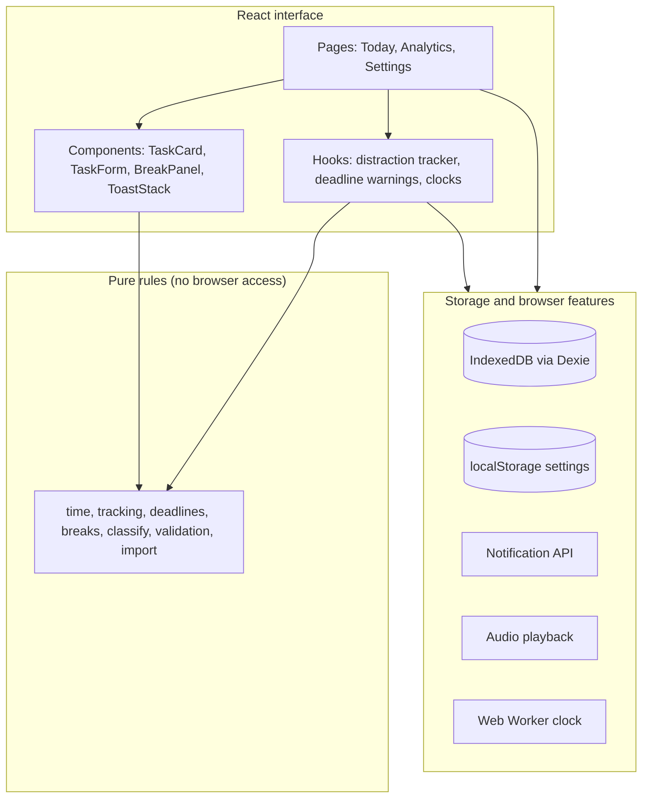
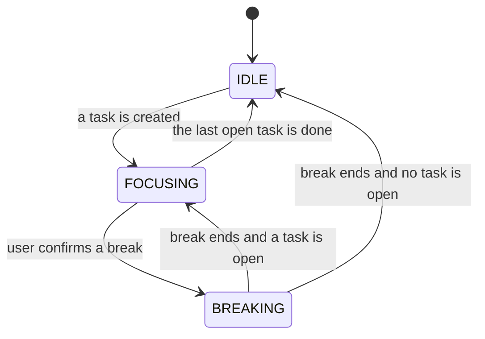
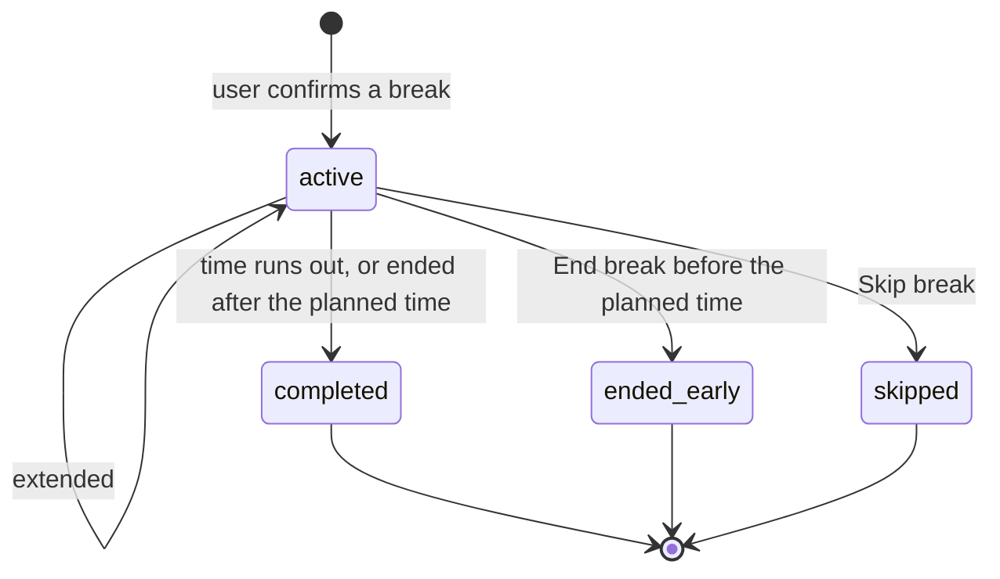
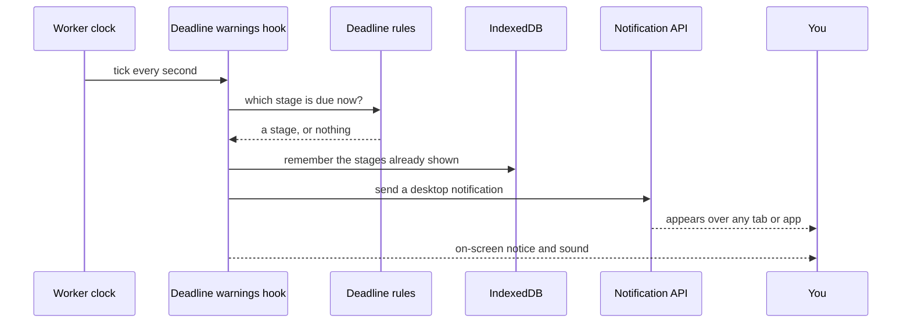
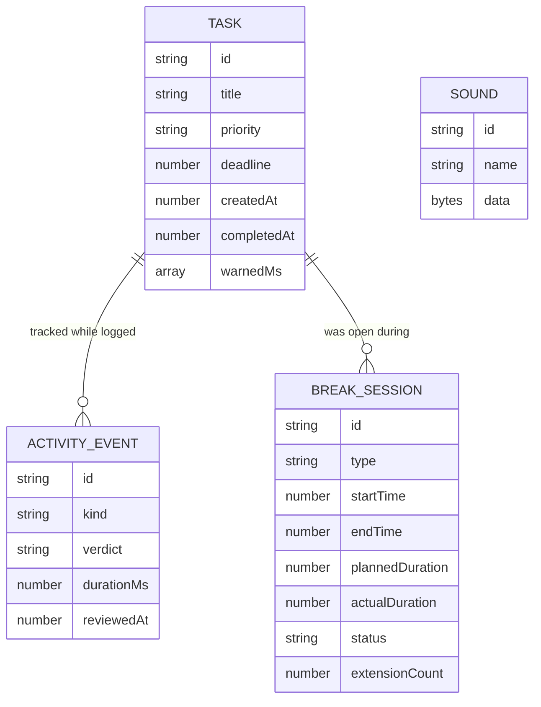

# NoCrast Architecture

A short, visual overview. For file-by-file detail, data schemas and how to extend the app, see the [developer guide](DEVELOPER_GUIDE.md). Decisions behind the design are in [DECISIONS.md](DECISIONS.md).

## 1. Layers

The code is split so that the rules which matter can be tested without a browser, and so that screens never talk to storage directly.

- **Rules** are plain functions. They take values in and return values out.
- **Services** wrap the database, settings, notifications, sound and break changes.
- **Pages and hooks** read data live from the database, so every screen updates when the data changes.

## 2. One clock, no counters

Nothing stores a running count. Every duration is computed from timestamps:

| Value | Formula |
|---|---|
| Time on a task | (when it was completed, or now) minus when it was created |
| Break time remaining | break start plus planned length, minus now |
| Time on a task excluding breaks (analytics) | time on task minus the overlap with breaks |

A one-second tick only tells the screen to redraw. This is why refreshing, sleeping or throttling cannot cause drift.

## 3. Application state

The app is always in one of three states, derived from the data rather than stored.

Distraction detection runs only in `FOCUSING`. Entering `BREAKING` suspends it, and leaving it restarts detection from a clean slate.

## 4. Break lifecycle

Only one break can be active. A break that expires while the app is closed is completed at its planned end time on the next load.

## 5. How a deadline warning reaches you

The worker clock exists because browsers slow ordinary timers in hidden tabs. The rules decide which single stage is due, so a task created close to its deadline gets one warning, not a pile.

## 6. Data model

Settings live in `localStorage`. The tables `sessions`, `timer` and `breaks` remain only for older data and export compatibility.

## 7. Folder map

| Folder | Responsibility |
|---|---|
| `src/pages` | Today, Analytics and Settings screens |
| `src/components` | Reusable pieces: common, tasks, breaks, interruptions, analytics, settings |
| `src/hooks` | Browser-aware behavior: tracking, warnings, clocks |
| `src/services` | Database, settings, notifications, sound, breaks, import and export, analytics |
| `src/utils` | The pure rules |
| `src/config` | Icons, messages and navigation in one place each |
| `src/tests` and `e2e` | Unit, component and browser tests |
