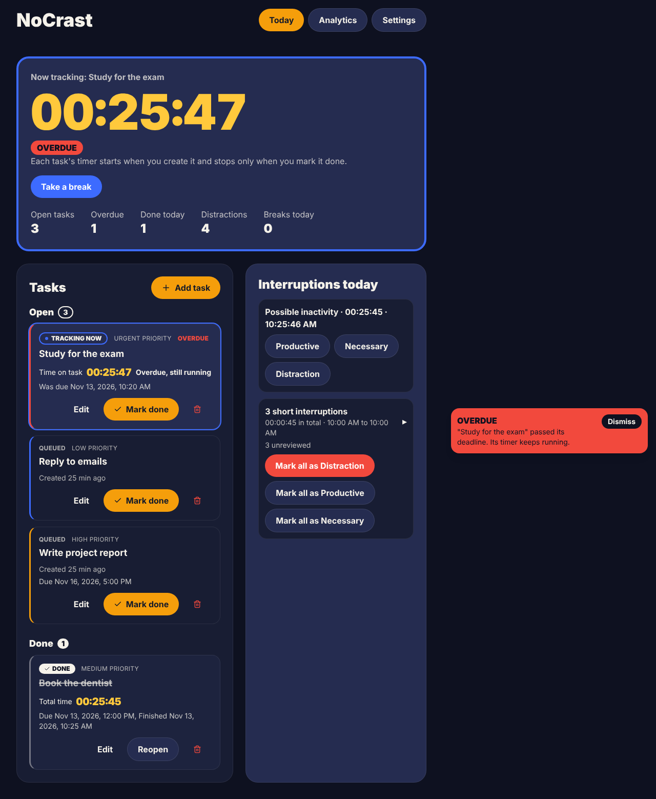
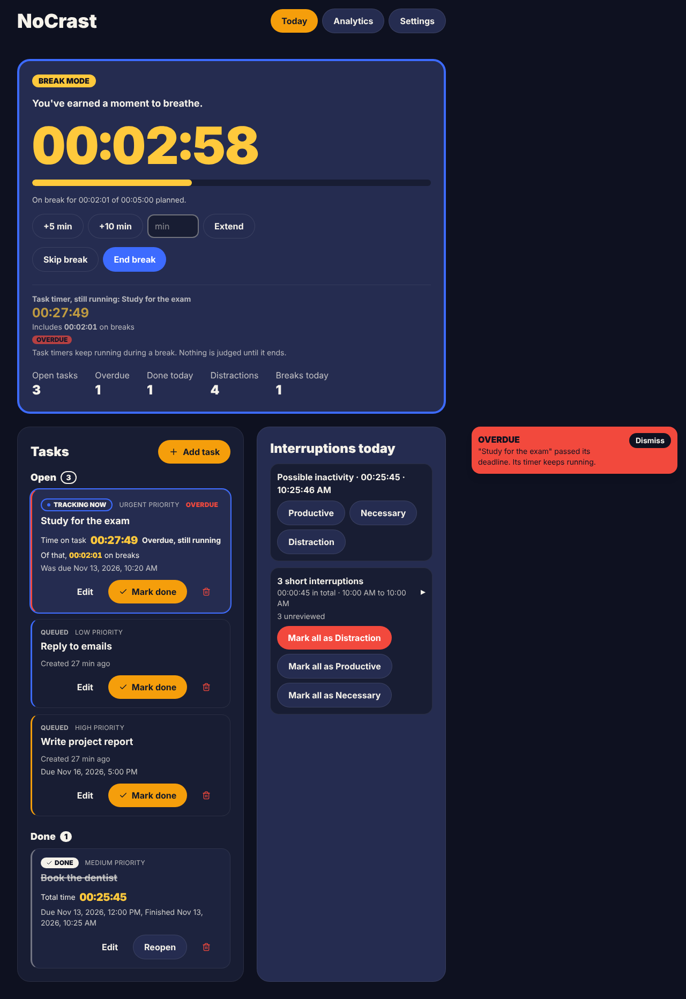
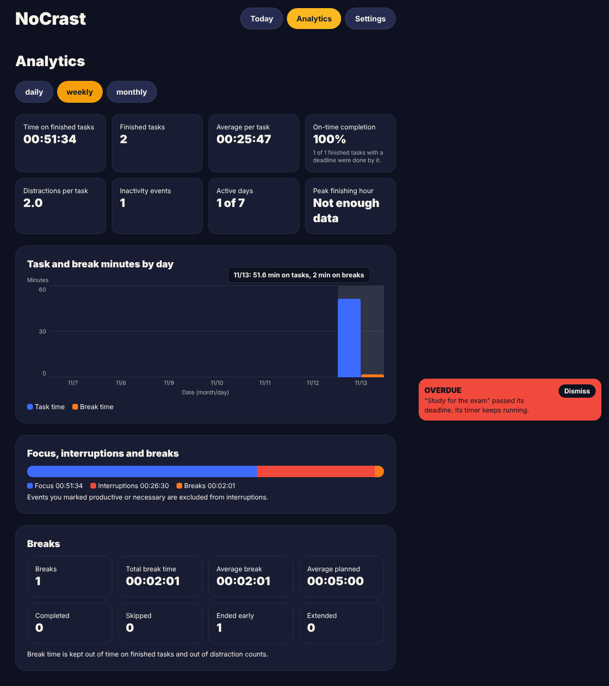

# NoCrast: a procrastination tracker that does not accuse you

A case study of a local-first web app for measuring how long work really takes, noticing when attention drifts, and showing the pattern without judging it.

[Watch the demo video](demo/nocrast-demo.mp4) (1 min 48 s, with captions).

## At a glance

| | |
|---|---|
| **What it is** | A web app that times every task from the moment it is created, warns you before deadlines, notices possible distractions, supports declared breaks, and shows your habits |
| **Built with** | React 19, TypeScript (strict), Vite, Tailwind CSS 4, Dexie (IndexedDB) |
| **Runtime dependencies** | 5 (react, react-dom, dexie, dexie-react-hooks, lucide-react) |
| **Size** | About 2,300 lines of source in 45 files, plus about 1,700 lines of tests |
| **Bundle** | 114 KB gzipped for the main script; Analytics and Settings load only when opened |
| **Testing** | 104 unit and component tests, 28 browser tests, all passing |
| **Quality audit** | Lighthouse: performance 100, accessibility 96 (one contrast finding, explained below), best practices 100, SEO 100 |
| **Data** | Stays in the browser. No accounts, no server, no analytics |

## Why I built it

Most productivity tools tell you what to do. Very few tell you what you actually did. I wanted to build something that measures how long work really takes, notices when attention drifts, and shows the pattern, without pretending to know why it happened.

Procrastination tools tend to fail in one of two ways. Some nag: they throw alarms and guilt at you until you switch them off. Others watch everything quietly and then hand you a verdict about your behavior. Neither treats the person using them as an adult who can interpret their own habits.

NoCrast is built on a different set of beliefs:

1. **Time should be measured, not remembered.** People are poor at estimating how long things took. A timer that starts by itself, the moment a task exists, removes the chance to forget to press Start.
2. **A computer can see that you left, not why.** Switching tabs might be research. Sitting still might be reading. So NoCrast only ever records a *possible* distraction, and you decide what it was.
3. **Rest is not failure.** If you say you are taking a break, the app believes you, stops judging, and keeps break time out of your productivity numbers.
4. **Your data is yours.** Everything is stored in your own browser. Nothing is sent anywhere.
5. **Serious tools can still have personality.** The tone is encouraging and a little playful ("Nice try getting it done before the deadline!"), never shaming.

<!-- Add a personal note here if you like: what prompted the project, what you wanted to learn, or who it is for. -->

## The problem it addresses

- Deadlines arrive quietly. The usual reminder comes once, or not at all.
- People rarely know how long a task actually takes, so they plan badly the next time.
- Distraction trackers guess, and a wrong accusation makes people stop trusting them.
- Many tools send your activity to a server, which is a lot to ask for a to-do list.

## What it does

| Area | Summary |
|---|---|
| **Tasks** | Title, description, category, priority and an exact deadline. Open and Done lists, with the tracked task, queued tasks and finished tasks clearly different. |
| **Timers** | Each task's clock starts when it is created and stops when it is marked done, even past the deadline. |
| **Deadline warnings** | 14 stages from 1 month out to overdue, each sent as a desktop notification, an on-screen notice and a sound of your choice. |
| **Distraction detection** | Logs tab switches and idle stretches as possible distractions. Accidental short switches are ignored. You label each one. |
| **Breaks** | Declared by you, with a countdown and extend, skip and end controls. Detection pauses and break time is tracked separately. |
| **Analytics** | Daily, weekly and monthly views of time on finished tasks, distractions per task, active days, and a separate breaks summary. |
| **Data control** | Export, import and delete everything. Choose your own notification sound. |

| Break mode | Analytics |
|---|---|
|  |  |

## Challenges and how I solved them

### 1. Timers that cannot drift
A timer that counts seconds goes wrong when a tab sleeps, a laptop closes or the page refreshes. NoCrast stores *timestamps* and always computes elapsed time from the clock: the time now minus the time the task was created. The one-second interval only redraws the screen. There is no counter to corrupt, so refreshing or sleeping cannot make a timer wrong.

### 2. Telling an accident from a distraction
The first version logged every tab switch, which would have filled the list with accidental clicks. Three changes fixed it: tab switches shorter than a minimum (10 seconds by default) are ignored, inactivity is only ever called *possible*, and the user labels each event as productive, necessary or a distraction. Only unreviewed and distraction-labeled events count. Labeled events leave the list after a minute so it never becomes a pile.

### 3. Warnings that reach you in another app
An in-page popup is useless if you are in another window. Warnings are therefore real desktop notifications, shown by the operating system over other tabs and applications. Browsers slow normal timers in hidden tabs to as little as once a minute, so the warning clock runs inside a Web Worker, whose timers are not slowed. Notifications still need the tab to stay open, because there is no server to push them, and the documentation says so plainly.

### 4. Breaks that do not pollute the numbers
A break must not count as productive time or as a distraction. Breaks are stored as their own records. Detection is suspended while a break is active and restarts fresh afterwards, so nothing from the break is judged later. Analytics subtract the overlap between each finished task and the breaks taken during it. A break that runs out while the app is closed is finished correctly on the next load, because everything is timestamp-based.

### 5. Keeping the rules testable
The rules that matter (timer math, which warning is due, which task is tracked, how breaks end) are pure functions with no browser access, so they are quick to test and safe to change. Storage and browser features sit in a thin service layer. Browser tests use a fake clock and a recording stand-in for the Notification API, so a 30 day warning schedule is checked in seconds.

### 6. Changing direction on purpose
I first built offline support (a service worker and installable app), then removed it. A plain web app is simpler, avoids stale cached files after updates, and was the shape I wanted. The decision, and the cleanup code that removes any old service worker, are recorded in [DECISIONS.md](DECISIONS.md).

### 7. A second pass for clarity
After using the first version I made a round of interface refinements without changing how tracking works. Several open tasks had shown identical ticking clocks, so only the tracked task now ticks and the rest say when they were created. Break mode now leads with the countdown and quietens the task timer. Runs of tiny interruptions are grouped, with bulk labeling. Priority became a thin colored edge instead of a row of badges, notices were re-anchored so they never block a button, and the analytics lost a duplicate number in favor of an on-time completion rate that is only shown when there are deadlines to judge. Each change has a browser test that checks the behavior, not just the look.

One trade-off is documented rather than hidden: the specified button colors give 4.43 to 1 contrast for white text on blue, just under the AA guideline for small text, so the accessibility score is 96, not 100. The fix is a small, token-only change.

## Quality and results

| Measure | Result |
|---|---|
| Unit and component tests | 104 passing, in 18 files |
| Browser tests (real Chromium) | 28 passing, in 4 files |
| Static checks | TypeScript strict mode and ESLint with no errors or warnings |
| Lighthouse (production build) | Performance 100, accessibility 96, best practices 100, SEO 100 |
| Main script | 361 KB, 114 KB gzipped |
| Network requests for user data | None |

Details are in [TEST_REPORT.md](TEST_REPORT.md).

## Limitations I am upfront about

- A web page can only see its own tab. It knows when you leave and return, never where you went. Seeing other sites would need a browser extension.
- Desktop notifications only work while NoCrast is open in a tab, and not on most phone browsers.
- Inactivity cannot tell reading from idling, which is why it is never treated as proof.
- The browser tests cannot prove that the operating system displays a notification, so that needs a manual check.

## What I learned

- **Putting rules in plain functions pays off.** Almost every requirement change (new warning stages, a different tie-break, break handling) touched a small tested file, not the screens.
- **Browsers decide what a page can know and do.** Designing around those limits honestly, rather than hiding them, made the product more trustworthy.
- **Fake clocks make time-based features testable.** Without them the deadline and break behavior could not have been verified in a reasonable time.
- **Say what you did not test.** Listing the gaps in the test report was more useful than a clean-looking claim.

## What could come next

- Time per category, and filtering the task list by category.
- An optional browser extension for site-level tracking, with explicit permission.
- Hosting the app online with a custom address.

## Read more

- [User guide](USER_GUIDE.md) and [developer guide](DEVELOPER_GUIDE.md)
- [Requirements](REQUIREMENTS.md), [architecture](ARCHITECTURE.md) and [decision records](DECISIONS.md)
- [Test report](TEST_REPORT.md) and [privacy notes](PRIVACY.md)
